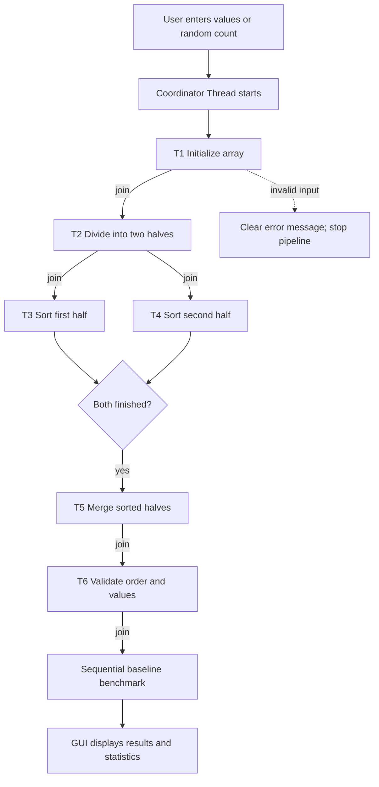

# Multithreaded Sorting Application

## University Project Report

**Course:** Operating Systems (901332)  
**University:** Al al-Bayt University  
**Semester:** First Semester 2026  
**Instructor:** Dr. Ashraf Al-Aoun  
**Project Title:** Multithreaded Sorting Application  
**Programming Language:** Java 17 (Swing GUI, standard library only)  
**Student:** ______________________  **ID:** ______________________  
**Submission Date:** ______________________

---

## Table of Contents

1. [Introduction](#1-introduction)
2. [Problem Statement](#2-problem-statement)
3. [Project Objectives](#3-project-objectives)
4. [Project Requirements](#4-project-requirements)
5. [Theoretical Background](#5-theoretical-background)
6. [Multithreading Concepts](#6-multithreading-concepts)
7. [System Design](#7-system-design)
8. [Thread Architecture](#8-thread-architecture)
9. [Implementation Details](#9-implementation-details)
10. [Important Java Code Explanations](#10-important-java-code-explanations)
11. [Screenshots of the Application](#11-screenshots-of-the-application)
12. [Testing and Results](#12-testing-and-results)
13. [Performance Comparison](#13-performance-comparison)
14. [Challenges and Solutions](#14-challenges-and-solutions)
15. [Conclusion](#15-conclusion)
16. [References](#16-references)

---

## 1. Introduction

Sorting is a fundamental operation in computer science and a classic example for
studying parallel processing. A sequential merge sort divides an array
recursively, sorts the parts, and merges them. In an operating-system course it
is useful to make the stages explicit as **real threads**, so that thread
creation, synchronization, shared memory, and scheduling become observable.

This project implements a Java Swing desktop application that sorts an integer
array with a six-thread pipeline. The first thread initializes the data, the
second divides it, two threads sort the halves concurrently, a fifth thread
merges the sorted halves, and a sixth validates the result. A coordinator thread
starts and joins the workers in the correct order while keeping the Swing Event
Dispatch Thread free.

The application also measures a sequential merge sort baseline on the same
input. The comparison deliberately shows that multithreading is **not
automatically faster**: thread creation and synchronization have real overhead.

---

## 2. Problem Statement

A single-threaded program can sort an array correctly, but it cannot demonstrate
how an operating system coordinates concurrent activities. The problem is to
build a teaching application that:

* divides an integer array into two nearly equal parts;
* sorts each part independently using separate Java threads;
* merges the sorted parts only after both sorting threads finish;
* validates the result;
* displays every intermediate stage in a graphical interface;
* handles odd lengths, duplicates, negatives, empty input, and invalid input;
* uses actual `Thread` objects, `start()`, and `join()` rather than a simulation;
* compares the parallel pipeline with a sequential merge sort without claiming
  that parallel execution is always advantageous.

---

## 3. Project Objectives

1. Apply thread creation and lifecycle management in Java.
2. Demonstrate concurrent execution of two independent sorting tasks.
3. Use `join()` to enforce precedence constraints between pipeline stages.
4. Show how threads can communicate safely through synchronized shared state.
5. Implement merge sort for even and odd array lengths.
6. Build a functional Swing GUI with real intermediate-array displays.
7. Validate correctness, not only sorted order but also preservation of values.
8. Compare sequential and multithreaded execution times honestly.
9. Provide documentation, presentation slides, and repeatable test cases.

---

## 4. Project Requirements

### 4.1 Functional requirements

| ID | Requirement |
|---|---|
| F1 | Accept integers separated by commas. |
| F2 | Generate a requested number of random integers. |
| F3 | Display original array, both halves, both sorted halves, and final array. |
| F4 | Display status, thread count, execution time, and validation result. |
| F5 | Provide Start Sorting and Reset controls. |
| F6 | Show clear error messages for empty and invalid input. |
| F7 | Include test-case presets for common input shapes. |

### 4.2 Operating-system requirements

| ID | Requirement | Implementation |
|---|---|---|
| O1 | Thread to initialize/fill array | `ArrayInitializerThread` (T1) |
| O2 | Thread to divide array | `ArrayDivisionThread` (T2) |
| O3 | Thread to sort first part | `SortingThread(true)` (T3) |
| O4 | Thread to sort second part | `SortingThread(false)` (T4) |
| O5 | Thread to merge sorted parts | `MergeThread` (T5) |
| O6 | At least six actual threads | T1–T6 plus coordinator = 7 actual Java Threads |
| O7 | Use `start()` | Every worker is started by the coordinator with `start()` |
| O8 | Use `join()` | Every dependent stage is synchronized with `join()` |
| O9 | Merge after both sorts | `firstSorter.join()` and `secondSorter.join()` precede T5 |
| O10 | Avoid race conditions | Defensive copies + `synchronized` context + `join()` ordering |
| O11 | Handle odd/even lengths | `middle = length / 2`; second half gets the extra element |

### 4.3 GUI requirements

The Swing window contains a dark-themed control column and a results column.
The results column includes a six-stage pipeline visualization and a scaled bar
chart of original versus final values. GUI updates are performed with
`SwingUtilities.invokeLater()` from the controller's callback implementation.

---

## 5. Theoretical Background

### 5.1 Process versus thread

A **process** is an instance of a program in execution with its own address
space. A **thread** is a lighter execution unit inside a process. Threads in the
same process share code, heap data, and open files, but each has its own program
counter, stack, and registers. Creating a thread is usually cheaper than
creating a process, but it is still not free.

### 5.2 Concurrency versus parallelism

* **Concurrency** means multiple activities make progress during overlapping
  time periods. On one CPU, this happens through scheduling.
* **Parallelism** means activities literally execute at the same time on
  multiple CPU cores.

The application requests concurrency by starting T3 and T4 together. Whether
they execute in true parallel depends on the hardware and JVM scheduler.

### 5.3 Merge sort

Merge sort is a divide-and-conquer algorithm:

1. Split the array into two halves.
2. Recursively sort each half.
3. Merge the two sorted halves with a two-pointer scan.

Time complexity is `O(n log n)` and auxiliary space is `O(n)`. The
implementation in `MergeSort.java` is stable because it takes from the left
half when two values are equal.

In this project the *top-level* split is performed by an explicit thread (T2),
and the two halves are sorted by explicit threads (T3/T4). Inside each half,
`MergeSort.sort()` uses ordinary recursive calls; those recursive calls are not
additional threads. This keeps the design understandable for an undergraduate
OS course.

---

## 6. Multithreading Concepts

### 6.1 Thread lifecycle in this project

```text
NEW  --start()-->  RUNNABLE  --run() completes-->  TERMINATED
                       |
                       +--join() called by coordinator --> coordinator waits
```

Calling `start()` asks the JVM to create a new thread of execution and invoke
`run()` on it. Calling `run()` directly would not create a new thread, so the
project always calls `start()`.

### 6.2 Why `join()` is essential

`join()` blocks the calling thread until the target thread terminates. Without
it, T5 could try to merge arrays that T3/T4 have not filled yet. The coordinator
therefore waits after every stage:

```java
firstSorter.start();
secondSorter.start();
firstSorter.join();   // T5 cannot start yet
secondSorter.join();  // both halves are now ready
```

### 6.3 Shared data and safe communication

Threads communicate through `SortingContext`. Two techniques prevent incorrect
access:

1. **Synchronized accessors:** every field read/write goes through a
   `synchronized` method, and getters return defensive copies.
2. **Happens-before from `join()`:** all writes made by a thread before it
   terminates are visible to the thread that calls `join()` and to threads
   started afterwards.

Workers also never write to the same array: T2 makes two independent copies,
then T3 and T4 sort only their own copy.

### 6.4 GUI thread safety

Swing components must only be modified on the Event Dispatch Thread (EDT). The
controller runs on its own background thread and calls `ProgressListener`. The
`MainFrame` implementation of that listener wraps every GUI change in
`SwingUtilities.invokeLater()`, so the window remains responsive.

### 6.5 Thread overhead

Thread creation, scheduling, context switching, and `join()` synchronization
consume time. For small arrays this overhead can be much larger than the sorting
work itself. This is why the project reports a sequential baseline and does not
claim that the threaded version is always faster.

---

## 7. System Design

### 7.1 High-level architecture

```text
+-----------------------+
|   Swing MainFrame     |  (Event Dispatch Thread)
|  input / displays     |
+-----------+-----------+
            | start coordinator Thread
            v
+-------------------------------------------------------+
| SortingController (Coordinator Thread)                |
|  start -> join -> start -> join ...                   |
+-------------------------------------------------------+
            | reports progress via ProgressListener
            v
+-------------------------------------------------------+
| SortingContext (synchronized shared state)            |
| original | halves | sorted halves | final | stats    |
+-------------------------------------------------------+
            |
   T1 -> T2 -> (T3 || T4) -> T5 -> T6
```

### 7.2 Flowchart



### 7.3 UML-style class overview

```text
Thread
  ^
  |-- SortingController --------> ProgressListener
  |-- ArrayInitializerThread ----> SortingContext
  |-- ArrayDivisionThread -------> SortingContext
  |-- SortingThread -------------> SortingContext, MergeSort
  |-- MergeThread ---------------> SortingContext
  `-- ValidationThread ----------> SortingContext, MergeSort

MainFrame --uses--> SortingController, ProgressListener, SortingContext
Main       --creates--> MainFrame
```

---

## 8. Thread Architecture

| Thread | Class | Input | Output | Synchronization |
|---|---|---|---|---|
| Coordinator | `SortingController` | GUI input / random count | Final callback with `SortingContext` | Starts and joins all workers |
| T1 | `ArrayInitializerThread` | Text or random count | `originalArray` | Joined before T2 |
| T2 | `ArrayDivisionThread` | `originalArray` | `firstHalf`, `secondHalf` | Joined before T3/T4 |
| T3 | `SortingThread(firstHalf=true)` | `firstHalf` | `sortedFirstHalf` | Joined before T5 |
| T4 | `SortingThread(firstHalf=false)` | `secondHalf` | `sortedSecondHalf` | Joined before T5 |
| T5 | `MergeThread` | Both sorted halves | `finalArray` | Joined before T6 |
| T6 | `ValidationThread` | Original + final array | `valid`, `validationMessage` | Joined before results |

**Total actual Java threads: 7** (six named workers plus the coordinator).
The GUI's EDT is an eighth JVM thread but is not counted as part of the sorting
pipeline.

---

## 9. Implementation Details

### 9.1 Source files

| File | Purpose |
|---|---|
| `Main.java` | Sets Look and Feel and shows `MainFrame` on the EDT. |
| `MainFrame.java` | Dark Swing GUI, controls, result panels, custom painted visualization. |
| `SortingController.java` | Coordinator `Thread`; enforces the pipeline with `start()`/`join()`. |
| `SortingContext.java` | Synchronized container for arrays, errors, validation, and timings. |
| `ProgressListener.java` | Callback contract used by GUI and headless tests. |
| `ArrayInitializerThread.java` | T1: parse input or generate random integers. |
| `ArrayDivisionThread.java` | T2: split at `length / 2` using `Arrays.copyOfRange`. |
| `SortingThread.java` | T3/T4: merge sort one half. Two instances are used. |
| `MergeThread.java` | T5: two-pointer merge. |
| `ValidationThread.java` | T6: sorted order + frequency-map comparison. |
| `MergeSort.java` | Reusable sequential merge sort algorithm. |

### 9.2 Execution workflow

1. The user presses **Start Sorting**. `MainFrame` creates a
   `SortingController` and calls `start()`.
2. T1 parses or generates values. Empty/invalid input produces an error and
   the controller stops.
3. T2 splits the array. For length `n`, first half size is `n / 2`, second half
   size is `n - n / 2`.
4. T3 and T4 start together. Each sorts a defensive copy with `MergeSort.sort`.
5. The coordinator joins both sorting threads. Only then is T5 started.
6. T5 merges the sorted halves into the final array.
7. T6 checks that the final array is sorted and that a frequency map of the
   final array matches the original.
8. The coordinator measures sequential merge sort on a copy of the original
   array and sends the complete `SortingContext` to the GUI.

### 9.3 GUI details

The window uses a slate/dark palette with cyan and violet accents. The left
panel contains input, a test-case combo box, random count, action buttons, and
statistics. The right panel contains the six-stage process visualization and
six read-only text areas for every array stage. Bars are scaled to the value
range; after merging, cyan bars represent elements from the first half and
violet bars represent elements from the second half.

### 9.4 Error handling

Input validation is deliberately performed inside T1 so that the OS workflow
remains visible. Errors are stored in `SortingContext` with the prefix
`T1 - Array Initialization`. After each `join()`, the coordinator checks
`hasError()` and throws an `IllegalStateException`, preventing dependent
threads from reading missing data. The GUI receives the message through
`onError()` and displays it in red.

---

## 10. Important Java Code Explanations

### 10.1 Coordinator ordering (`SortingController.java`)

```java
Thread firstSorter = new SortingThread(true, context, listener);
Thread secondSorter = new SortingThread(false, context, listener);
firstSorter.start();
secondSorter.start();
firstSorter.join();
secondSorter.join();

Thread merger = new MergeThread(context, listener);
merger.start();
merger.join();
```

This is the central OS requirement: T3 and T4 overlap, while T5 has a strict
precedence constraint.

### 10.2 Safe shared state (`SortingContext.java`)

```java
public synchronized void setHalves(int[] first, int[] second, long elapsedNanos) {
    this.firstHalf = copyOf(first);
    this.secondHalf = copyOf(second);
    this.divisionNanos = elapsedNanos;
}

public synchronized int[] getFirstHalf() {
    return copyOf(firstHalf);
}
```

`synchronized` serializes access; the defensive copy prevents a caller from
mutating shared state after a worker has published it.

### 10.3 Merge implementation (`MergeThread.java`)

```java
while (i < left.length && j < right.length) {
    if (left[i] <= right[j]) {
        merged[k++] = left[i++];
    } else {
        merged[k++] = right[j++];
    }
}
```

The `<=` comparison keeps the merge stable when duplicates appear.

### 10.4 Validation (`ValidationThread.java`)

```java
boolean orderIsCorrect = MergeSort.isSorted(result);
boolean valuesMatch = sameMultiset(original, result);
```

Checking only `isSorted` would miss lost or duplicated values. The frequency
map makes the validation robust for negative numbers and duplicates.

### 10.5 EDT-safe GUI updates (`MainFrame.java`)

```java
@Override
public void onProgress(String message, int phase) {
    SwingUtilities.invokeLater(() -> {
        setStatus(message, false);
        processPanel.setPhase(phase);
        processPanel.repaint();
    });
}
```

The controller never touches Swing components directly.

---

## 11. Screenshots of the Application

> **Important academic honesty note:** the Java build environment used to
> prepare this report was headless (no graphical display), so the Swing window
> was **not** launched and no screenshot was captured. The frames below are
> placeholders. Insert real screenshots after running `./java/run.sh` on a
> desktop. Do not submit fabricated images.

**Figure 1 — Main window after launching the application.**  
*Insert real screenshot here: controls on the left, pipeline visualization on
the right.*

**Figure 2 — Pipeline during T3/T4 concurrent sorting.**  
*Insert real screenshot here: stages 3 and 4 highlighted, status message from
the coordinator.*

**Figure 3 — Completed run with final sorted array and statistics.**  
*Insert real screenshot here: six array panels filled, validation visible,
execution time and comparison displayed.*

**Figure 4 — Invalid input error.**  
*Insert real screenshot here: status bar shows the T1 error message in red.*

---

## 12. Testing and Results

The headless suite `SortingApplicationTest.java` was compiled and executed with
Temurin OpenJDK 17.0.21.1. It runs the actual `SortingController`, not a
simulation. Each successful test asserts that all six worker threads reported
progress and that `T6` reported `VALID`.

| Test | Purpose | Result |
|---|---|---|
| Small array | General case with duplicates and negatives | PASS |
| Already sorted | Best-shaped input | PASS |
| Reverse sorted | Worst input order for many algorithms | PASS |
| Duplicates | Stability/preservation check | PASS |
| Negative numbers | Correct comparison and hashing | PASS |
| Odd-sized array | Unequal halves (5 + 6) | PASS |
| Single element | Empty first half | PASS |
| Large generated case (500) | Larger deterministic workload | PASS |
| Large random array (1,000) | Random workload | PASS |
| Empty input | Error handling | PASS |
| Invalid integer | Error handling | PASS |
| Empty token | Error handling | PASS |

Observed output:

```text
RESULT: 12/12 tests passed.
```

Full inputs, expected outputs, and commands are documented in
`docs/TEST_CASES.md`.

### GUI runtime status

The GUI source compiled with zero warnings under `javac -Xlint:all`, but it was
not launched in the headless build environment. GUI behaviour must be confirmed
manually on a desktop; no runtime GUI result is claimed here.

---

## 13. Performance Comparison

The real benchmark `PerformanceBenchmark.java` executed one warm-up and five
measured runs per size using the same JDK and a **2-processor** environment.

| Elements | Parallel pipeline (ms) | Sequential merge sort (ms) | seq/par |
|---------:|-----------------------:|---------------------------:|--------:|
| 100 | 1.380 | 0.019 | 0.01x |
| 1,000 | 1.886 | 0.137 | 0.07x |
| 10,000 | 7.107 | 1.140 | 0.16x |
| 50,000 | 12.965 | 6.031 | 0.47x |

The `seq/par` ratio is sequential time divided by parallel pipeline time. A
value below 1 means the sequential version was faster. In this environment the
sequential version was faster for every tested size.

### Why did the threaded pipeline take longer?

1. Seven Java Threads were created and scheduled for every run.
2. `join()` calls block the coordinator five times.
3. Results are copied defensively between stages.
4. Only two processors were available, so the two sorting threads had limited
   room to overlap.
5. Merge sort is memory-bandwidth intensive; two halves compete for memory.

This is a correct and valuable result. Multithreading can improve throughput
when work is large and independent enough to amortize overhead, but it is not a
universal optimization. Students should explain the measured numbers rather
than assume "more threads = faster".

---

## 14. Challenges and Solutions

| Challenge | Solution |
|---|---|
| T5 could merge incomplete data | Coordinator joins both sorting threads before starting T5. |
| Shared mutable arrays could cause race conditions | Defensive copies, synchronized accessors, and stage ordering with `join()`. |
| Swing could freeze during sorting | Sorting runs on a background coordinator Thread; GUI callbacks use `invokeLater()`. |
| Odd arrays produce unequal halves | Division at `length / 2`; merge handles empty halves. |
| Invalid input could crash parsing | T1 validates tokens and reports precise position of bad values. |
| Duplicates could be lost during validation | Frequency-map comparison validates multiset equality. |
| Comparison might be misleading | Report raw times and explain overhead; never claim guaranteed speedup. |
| Headless environment prevented screenshots | Placeholders clearly marked; no image fabricated. |

---

## 15. Conclusion

The project delivers a complete Java Swing application that satisfies all
mandatory OS requirements. It creates seven actual Java Threads, starts each
with `start()`, synchronizes dependent stages with `join()`, and enforces that
merging occurs only after both sorting threads terminate. The synchronized
`SortingContext` and defensive copies prevent shared-data problems, while the
EDT-safe callbacks keep the GUI responsive.

All twelve headless tests passed. The measured comparison showed that the
sequential version was faster on the test hardware, which reinforces an
important operating-system lesson: concurrency has costs, and parallelization
must be justified by workload, cores, and overhead. The source code, report,
presentation, and test documentation are organized so an undergraduate student
can explain and defend every component.

---

## 16. References

1. Oracle. *Java Platform, Standard Edition 17 API Specification* — `java.lang.Thread`, `javax.swing.SwingUtilities`, `java.util.Arrays`. https://docs.oracle.com/en/java/javase/17/docs/api/
2. Oracle. *Lesson: Concurrency in Java* (The Java Tutorials). https://docs.oracle.com/javase/tutorial/essential/concurrency/
3. Oracle. *Lesson: Concurrency in Swing*. https://docs.oracle.com/javase/tutorial/uiswing/concurrency/
4. Cormen, T. H., Leiserson, C. E., Rivest, R. L., & Stein, C. *Introduction to Algorithms*, 3rd ed., MIT Press, 2009 — Merge Sort chapter.
5. Silberschatz, A., Galvin, P. B., & Gagne, G. *Operating System Concepts*, 10th ed., Wiley — chapters on threads and CPU scheduling.
6. Course material, Operating Systems (901332), Al al-Bayt University, First Semester 2026.

---

*End of report.*
